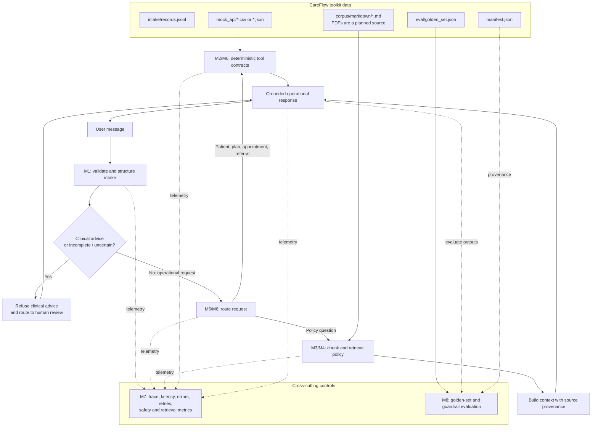

# CareFlow Architecture

## Purpose and scope

CareFlow is a synthetic-data care-coordination assistant. It supports operational
intake, policy lookup, and deterministic reads of patient, plan, appointment, and
referral data. It does **not** diagnose, interpret symptoms, or recommend
treatment or medication. Clinical-advice requests are refused and routed for
human review.

The M1–M8 notebooks are milestone demonstrations of this design, not a single
deployed application. The diagram below shows how their responsibilities fit
together; implementation status and important gaps are called out below.

## End-to-end view



## Data and component responsibilities

| Milestone | Responsibility | Inputs and outputs |
|---|---|---|
| [M1](../notebooks/CareFlow_M1.ipynb) | Provider-agnostic structured intake. Validates an `IntakeRequest`, asks an LLM client for schema-constrained JSON, validates the result as `StructuredIntake`, and evaluates extracted fields against ground truth. | Reads `data/careflow/intake/records.jsonl`. Structured output includes record and patient references, intent, urgency, specialty, insurance ID, clinical-advice flag, missing fields, human-review flag, and rationale. |
| [M2](../notebooks/CareFlow_M2.ipynb) | Deterministic tool agent over mock relational data. Tool functions read patient, plan, appointment, and referral rows; a simple router chooses a tool. | Reads `data/careflow/mock_api/`. The data/tool layer, not a generated answer, is authoritative for operational records. |
| [M3](../notebooks/CareFlow_M3.ipynb) | Policy document ingestion, chunking, and a lightweight lexical index. | Reads Markdown policy documents and creates word-window chunks with source and chunk identifiers. The notebook's current ingestion example handles Markdown; PDF ingestion is not implemented there. |
| [M4](../notebooks/CareFlow_M4.ipynb) | Retrieval-augmented response baseline and retrieval evaluation cases. | Retrieves lexical matches, attaches source names to context, and defines an answer contract: answer only from context, cite sources, and route uncovered questions rather than inventing policy. |
| [M5](../notebooks/CareFlow_M5.ipynb) | Typed LangGraph workflow combining deterministic intake classification, policy retrieval, read-only mock-data lookups, and response stages. | Uses conditional edges for clinical refusal, policy retrieval, and operational tools; interrupts to clarify a missing synthetic patient reference and resumes with an in-memory checkpointer. |
| [M6](../notebooks/CareFlow_M6.ipynb) | Multi-agent responsibility split and an MCP-shaped tool boundary. | Describes a supervisor, intake agent, policy agent, and operations agent, with patient/plan/appointment/referral tool contracts. |
| [M7](../notebooks/CareFlow_M7.ipynb) | Observability and reliability patterns. | Trace IDs, step/status/latency metadata, bounded retry example, and proposed signals such as tool errors, human-review rate, refusals, retrieval hits, and citation coverage. |
| [M8](../notebooks/CareFlow_M8.ipynb) | Golden-set evaluation, safety checks, and deployment readiness. | Reads `data/careflow/eval/golden_set.json`; checks expected routes and forbidden response phrases in guardrail examples; defines a broader evaluation scorecard. |

`data/careflow/manifest.json` records toolkit provenance. Preserve it with the
generated assets and use it as evidence in evaluation and submission materials.
Generated input data is immutable; mutable runtime state belongs under
`runtime/mock_api/`.

## Contracts and safety boundaries

### Intake

`IntakeRequest` is the validated incoming record; `StructuredIntake` is the
validated extraction result. Missing specialty or insurance details are made
explicit rather than guessed. The intake prompt directs clinical-advice requests
to set both the advice flag and human-review flag.

### Operational tools

The tool contracts are read-only lookups keyed by patient reference or plan
code. Agent/supervisor logic selects a tool, while deterministic handlers access
the mock API tables. In a production implementation, authorization and
patient/entity scoping must be enforced at this boundary; the notebooks do not
demonstrate a production identity or authorization service.

### Retrieval and response grounding

Policy documents are split into overlapping word windows and ranked using
lexical term overlap. A retrieved chunk retains its source name and chunk ID for
provenance. The response generator should receive the question and retrieved
context, be constrained to that context, and cite its sources. An unsupported
question must be identified as uncovered and routed appropriately; retrieval
must not be used to provide clinical advice.

### Clinical safety

Clinical scope checks take precedence over operational tool use and policy
answers. Requests for diagnosis, symptom interpretation, or medication/treatment
advice are refused and escalated to a licensed clinician. A user claiming to be
a clinician does not create an exception. Emergency guidance and escalation
language should follow the approved clinical escalation policy; the assistant
must not make a diagnosis or recommend medication.

## Workflow state

The M5 state sketch carries:

- `raw_message` and optional `patient_ref`
- extracted `intake` fields
- `tool_result` and `retrieved` policy evidence
- selected `route` and final `answer`
- ordered `events` for the steps taken

The conceptual request path is:

```text
message -> structured intake -> safety/routing decision
        -> policy retrieval OR deterministic operational tool
        -> grounded response or human-review response
```

## Observability and evaluation

M7 proposes per-step trace IDs, status, latency, and error metadata; bounded
retries; and dashboard measures for end-to-end latency, tool latency/errors,
retrieval hit rate, human-review/refusal rates, fallbacks, and citation coverage.
Logs should use identifiers and operational metadata rather than raw patient
messages by default.

M8's official set contains 20 cases and covers factual, multi-hop, unanswerable,
guardrail, and injection requests. The saved notebook run counted 9 factual,
5 unanswerable, 3 multi-hop, 2 guardrail, and 1 injection case; this differs
from the target distribution written in the notebook and should be reconciled.
The notebook currently demonstrates guardrail checks on two sample responses;
that is not equivalent to executing and scoring the full golden set.

## Implementation status and limitations

- **M5 is an executable LangGraph baseline, not a production agent.** Its
  classifier is deterministic and heuristic; retrieval uses lexical matching;
  tool handlers read the generated tables (or explicitly reported demo
  fixtures). It does not call an LLM or import the M2/M4 notebook functions as
  libraries. The in-memory checkpointer supports the notebook's clarification
  demo but does not survive kernel restarts.
- **M6 models agent roles and an MCP contract, not a live multi-agent service or
  MCP server.** Its example registry uses illustrative handlers; wire it to the
  deterministic M2 functions and a real protocol server before treating the
  boundary as operational.
- **M3/M4 retrieval is a dependency-light lexical baseline.** It is not a
  vector database or embedding search, and PDF ingestion is not yet shown in
  the notebook implementation.
- **M7 signals and reliability gates are examples.** The notebooks do not
  configure production telemetry, durable retries, alerting, or a dashboard.
- **M8's guardrail function is a simple route/string check.** Full-set execution,
  citation validation, retrieval metrics, answer-quality scoring, and deployment
  gates still need to be implemented and recorded.
- **Persistent conversation or entity-scoped memory is not implemented by these
  notebooks.** The M3 policy index is reusable policy knowledge, not patient
  memory.
